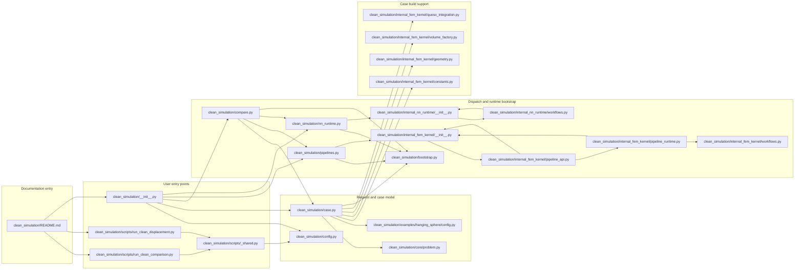
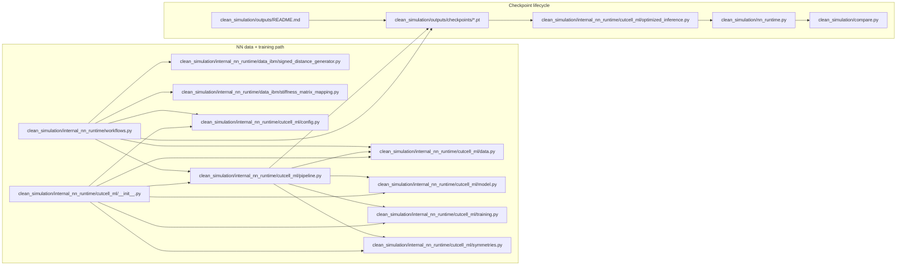

???# Clean Simulation Workspace

This package is the orchestration layer for FEM-only and FEM+NN workflows.

## Start Here

- [Architecture](docs/architecture.md) describes the public framework and
    ownership boundaries.
- [Architecture target](docs/architecture_target.md) defines the smaller
    end-state package structure and compatibility migration rules.
- [Training and checkpoints](docs/training.md) gives the same local and remote
    command path, including configuration and run inspection.
- [Metrics](docs/metrics.md) defines the training, validation, and physical
    diagnostics reported by the pipeline and control panel.
- [Scripts](scripts/README.md) distinguishes supported portable commands from
    named studies, audits, and local investigation helpers.

## What This README Adds

This README is focused on structure visibility.

- end-to-end workflow diagrams
- explicit checkpoint lifecycle map
- full Python file inventory inside clean_simulation

## Workflow 1: User Entry to Runtime Dispatch



## Workflow 2: FEM Kernel Runtime Dynamics

```mermaid
%%{init: {"flowchart": {"htmlLabels": false}} }%%
flowchart TB
    subgraph RuntimeEntry["FEM runtime dispatch"]
        FRP["clean_simulation/internal_fem_kernel/runtime/pipelines.py"]
        AOps["clean_simulation/internal_fem_kernel/runtime/assembly_ops.py"]
        Solve["clean_simulation/internal_fem_kernel/runtime/solver.py"]
        Common["clean_simulation/internal_fem_kernel/runtime/common.py"]
        NNBridge["clean_simulation/internal_nn_runtime/cutcell_bridge.py"]
    end

    subgraph FEMCore["Internal FEM kernel"]
        Fem["clean_simulation/internal_fem_kernel/fem.py"]
        Boundary["clean_simulation/internal_fem_kernel/boundary.py"]
        Classification["clean_simulation/internal_fem_kernel/classification.py"]
        ForceFactory["clean_simulation/internal_fem_kernel/force_factory.py"]
        Kinematics["clean_simulation/internal_fem_kernel/kinematics.py"]
        Shape["clean_simulation/internal_fem_kernel/shape.py"]
        Tensor["clean_simulation/internal_fem_kernel/tensor.py"]
        Viz["clean_simulation/internal_fem_kernel/visualization.py"]
    end

    subgraph FEMSubpackages["Assembly, integration, and indexing"]
        AInit["clean_simulation/internal_fem_kernel/assembly/__init__.py"]
        AForce["clean_simulation/internal_fem_kernel/assembly/force.py"]
        AGlobal["clean_simulation/internal_fem_kernel/assembly/global_system.py"]
        ANitsche["clean_simulation/internal_fem_kernel/assembly/nitsche.py"]
        AStiff["clean_simulation/internal_fem_kernel/assembly/stiffness.py"]
        CInit["clean_simulation/internal_fem_kernel/core/__init__.py"]
        GIndex["clean_simulation/internal_fem_kernel/core/grid_indexing.py"]
        IForce["clean_simulation/internal_fem_kernel/integration/element_force.py"]
        IStiff["clean_simulation/internal_fem_kernel/integration/element_stiffness.py"]
        IGauss["clean_simulation/internal_fem_kernel/integration/gauss_integration.py"]
        INitsche["clean_simulation/internal_fem_kernel/integration/nitsche_bc.py"]
        IOctree["clean_simulation/internal_fem_kernel/integration/octreesampler.py"]
    end

    FRP --> Common
    FRP --> AOps
    FRP --> Solve
    FRP --> Fem
    FRP --> NNBridge
    AOps --> GIndex
    AOps --> Shape
    AOps --> Fem
    Solve --> Fem
    Solve --> ANitsche
    Solve --> AGlobal

    Fem --> AInit
    Fem --> CInit
    Fem --> IForce
    Fem --> IStiff
    Fem --> IGauss
    Fem --> INitsche
    Fem --> IOctree
    Fem --> Boundary
    Fem --> Classification
    Fem --> ForceFactory
    Fem --> Kinematics
    Fem --> Shape
    Fem --> Tensor
    Fem --> Viz

    AInit --> AForce
    AInit --> AGlobal
    AInit --> ANitsche
    AInit --> AStiff
    CInit --> GIndex
```



## Workflow 3: NN Training, Checkpoints, and Inference



## Ownership Map

Use these modules by responsibility instead of navigating a file inventory:

- **Public API:** `case.py`, `config.py`, `compare.py`, `pipelines.py`,
  `runner.py`, and `nn_runtime.py`.
- **Applications:** `scripts/training`, `scripts/data`, `scripts/workflows`,
  `scripts/audits`, and `scripts/operations`.
- **Numerical engines:** `internal_fem_kernel`, `internal_nn_runtime`, and
  `queso`.
- **Research reproductions:** `scripts/studies` and the named compatibility
  runners that they delegate to.

The [architecture target](docs/architecture_target.md) defines the dependency
rules, active transitional boundaries, and safe migration sequence.

The [notebook guide](notebooks/README.md) lists the purpose-based preferred
notebook paths and their historical compatibility copies.

## Quick Use (CLI)

From workspace root:

```powershell
python -m clean_simulation.scripts.workflows.compare_pipelines --pipelines classic,queso --reference classic --device cpu
```

With NN-backed pipelines and checkpoint:

```powershell
python -m clean_simulation.scripts.workflows.compare_pipelines --pipelines classic,hybrid,queso_nn,full_nn --reference classic --nn-checkpoint "path/to/model_checkpoint.pt"
```

Global displacement export:

```powershell
python -m clean_simulation.scripts.workflows.export_displacement_fields --pipelines classic,queso --output-dir outputs/clean_simulation/displacements
```

## Migration Quick Guide

Use this mapping if you are moving from old notebook-heavy flows to the clean API:

- Build a request in one line with `make_comparison_request(...)`.
- Run benchmark timing and precision in one call with `run_comparison_once(...)`.
- Use `compare_with_queso_defaults(...)` when you want classic vs queso by default.

Python one-call example:

```python
from clean_simulation import run_comparison_once

result = run_comparison_once(
    pipelines="classic,queso",
    reference_pipeline="classic",
    device="cpu",
)

for row in result["rows"]:
    print(row["pipeline"], row["total_time_s"], row["relative_l2_error_vs_reference"])
```

## AWS Hanging-Sphere Study

[`notebooks/05_local_stiffness_convergence.ipynb`](notebooks/05_local_stiffness_convergence.ipynb) is the canonical checkpointed four-framework convergence study. It never overwrites an existing framework/resolution checkpoint and does not launch solves unless explicitly enabled.

Before starting Jupyter on the instance, configure persistent output storage and the target GPU:

```powershell
$env:HANGING_SPHERE_OUTPUT_DIR = "D:\persistent-results\sphere_displacement_convergence"
$env:HANGING_SPHERE_DEVICE = "cuda"
$env:HANGING_SPHERE_CPU_THREADS = "16"
$env:HANGING_SPHERE_RESOLUTIONS = "8,16,32,64,128,256"
$env:HANGING_SPHERE_REFERENCE_RESOLUTION = "256"
$env:HANGING_SPHERE_RUN_SOLVES = "1"
```

For a resume or evaluation-only session, leave `HANGING_SPHERE_RUN_SOLVES` unset. The notebook prints the selected device, GPU memory, output directory, and execution guard in its configuration cell. Its retained formulation uses a plane-only nested cap at $z=6.75$; legacy curved-Nitsche and experimental launch paths have been removed.

Root-level CLIs:

```powershell
python run_clean_comparison.py --pipelines classic,queso --reference classic --device cpu
python run_clean_displacement.py --pipelines classic,queso --output-dir outputs/clean_simulation/displacements
python run_queso_comparison.py --pipelines classic,queso --reference classic
```
